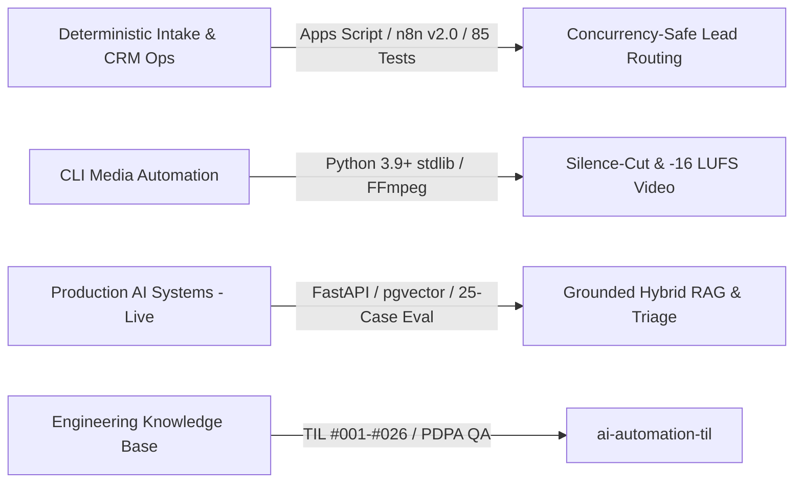

# Hi, I'm Sinlapachai Kaeobunrueang (Apec) 👋

**AI & AI Automation Engineer**  
*Building production RAG systems, reliable workflow automation, and deterministic backend tooling with measurable evaluation & cost control.*

📍 Bangkok, Thailand · 🎓 B.S. Digital Technology & Innovation (GPA **3.84**) · 🌐 TOEIC **845** (CEFR B2)

---

## 🚀 Engineering Focus

I build **reliable AI and automation systems** designed for real-world operations—combining **deterministic software engineering** (when rules and schema validation beat LLM latency and cost) with **production AI engineering** (Hybrid RAG, structured outputs, evaluation gates, and workflow orchestration).

- **Backend & Data:** Python (`FastAPI`, `Pydantic`, `Pytest`), `PostgreSQL / pgvector`, Node.js, Google Apps Script
- **AI & Automation Systems:** Hybrid RAG (`pgvector` + Full-Text/BM25), Gemini API Structured Outputs, `n8n`, `Docker`, `GitHub Actions`
- **Engineering Discipline:** Automated offline test suites, PDPA/secret hygiene gates, hallucination refusal, and token cost control

---

## 🎬 Flagship Live Demo — `enterprise-rag-ops-copilot`

**Thai–English Hybrid RAG Copilot & Guarded Ticket Triage API** running on a `$0` free-tier production stack (`Vercel` + `Render` + `Supabase pgvector`) — verified with **`47/47` Pytest** and **`25/25` Live & CI Golden Eval** (`767 ms` avg / `1516 ms` P95).

🔗 **[Try the No-Login Live Demo](https://enterprise-rag-ops-copilot.vercel.app/)** · 📂 **[Explore the Repository](https://github.com/ApecSinlapachai/enterprise-rag-ops-copilot)** · 🩺 **[Live API Health](https://enterprise-rag-ops-copilot-api.onrender.com/health)**

  
   
  <em>Click preview to launch the Live Demo — Hybrid RRF (pgvector + PyThaiNLP + pg_trgm), 3-Stage $0 Guardrails, Tiered Gemini 3.x Routing &amp; Pydantic v2 Triage</em>

---

## 🛠️ Featured Public Repositories

| Repository | Focus & Engineering Signal | Verified Stack & Metrics |
| :--- | :--- | :--- |
| **[enterprise-rag-ops-copilot](https://github.com/ApecSinlapachai/enterprise-rag-ops-copilot)** ([Live Demo](https://enterprise-rag-ops-copilot.vercel.app/)) | **Thai–English Hybrid RAG & Guarded Ticket Triage:** `pgvector` + `PyThaiNLP` + `pg_trgm` RRF, 3-stage `$0` anti-hallucination/injection guardrails, tiered Gemini 3.x routing, and Pydantic v2 structured outputs | `FastAPI` · `Next.js 15` · `PostgreSQL 16 (pgvector)` · `Docker` · **`47/47` Pytest · `25/25` Live & CI Golden Eval** |
| **[fast-lead-automation](https://github.com/ApecSinlapachai/fast-lead-automation)** | **Deterministic Automation — Knowing When Not to Use AI:** Concurrency-safe webhook intake, regex normalization, deduplication, and LINE Flex alerts (`$0/mo` SaaS overhead) | `Google Apps Script` · `n8n v2.0` · `LINE Messaging API` · `Node.js` · **`85/85` Automated Offline Tests** (`45 + 28 + 12`) |
| **[agentic-media-pipeline](https://github.com/ApecSinlapachai/agentic-media-pipeline)** | **CLI Media Automation Pipeline:** Deterministic 0-dependency Python + FFmpeg CLI for silence removal, contact-sheet inspection, and `-16 LUFS` loudness normalization | `Python 3.9+ (0-dep stdlib)` · `FFmpeg / FFprobe` · Verified run: **`27:00 → 10:37`**, **`-41.8 dB → -20.1 dB`** |
| **[ai-automation-til](https://github.com/ApecSinlapachai/ai-automation-til)** | **Public Engineering Notes (`TIL #001–#026`):** English technical notes on AI systems, context engineering, workflow reliability, and PowerShell QA gates | `AI Systems` · `Context Engineering` · `Automation Ops` · `PDPA/Secret QA` |

> **Flagship AI Portfolio Roadmap:**  
> 1. **Project #1 — `enterprise-rag-ops-copilot`** *(✅ Shipped & Live)*: Thai–English Hybrid RAG (`PostgreSQL 16 + pgvector` + `PyThaiNLP` + `pg_trgm`), 3-stage `$0` hallucination/injection guardrails, Pydantic v2 Ticket Triage, `25/25` Live & CI Golden Eval Gate, `47/47` Pytest, Docker + GitHub Actions CI, and [No-Login Vercel Live Demo](https://enterprise-rag-ops-copilot.vercel.app/).  
> 2. **Project #2 — `production-ai-agent-ops`** *(Queued)*: Explicit State-Machine Agent (`LangGraph`), `PII Redaction (PDPA)`, Human-in-the-Loop Approval Gate, `Idempotency Key / Retry+Backoff / DLQ`, `n8n` JSON integration, and `50–70%` Model Routing Cost Benchmark.

---

## 🧩 Systems Architecture Overview

---

## 📫 Connect

- **LinkedIn:** [linkedin.com/in/apec-sinlapachai](https://www.linkedin.com/in/apec-sinlapachai)
- **YouTube:** [AI & Automation Walkthroughs](https://youtu.be/V7EboxNpv0Y)
- **Email:** [sinlapachai.kaeobunrueang@gmail.com](mailto:sinlapachai.kaeobunrueang@gmail.com)
