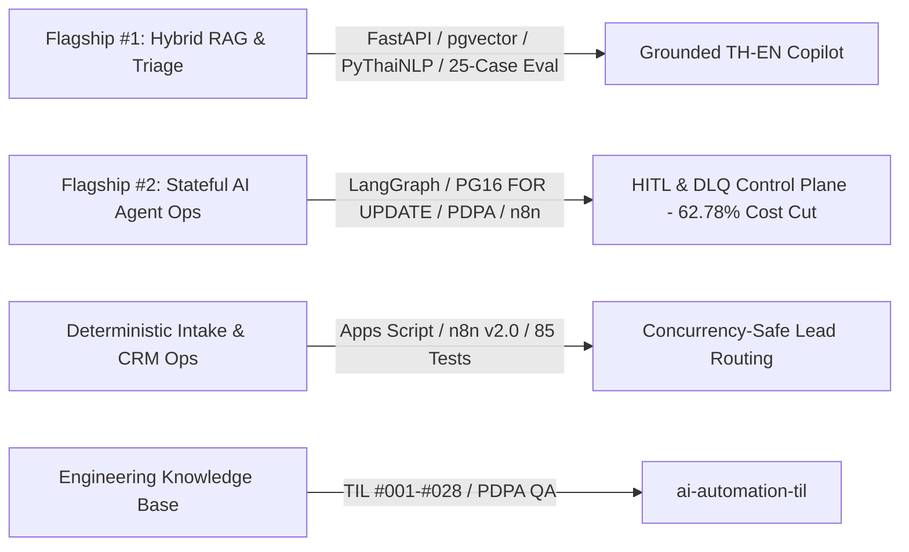

# Hi, I'm Sinlapachai Kaeobunrueang (Apec) 👋

**AI & AI Automation Engineer**  
*Building production Hybrid RAG systems, stateful AI Operations Agents, and deterministic workflow automation with measurable evaluation, PDPA guardrails & LLM cost control.*

📍 Bangkok, Thailand · 🎓 B.S. Digital Technology & Innovation (GPA **3.84**) · 🌐 TOEIC **845** (CEFR B2)

---

## 🚀 Engineering Focus

I build **production-minded AI and automation systems** designed for real-world operations—combining **deterministic software engineering** (when rules, SQL locking, and schema validation beat LLM latency and cost) with **applied AI engineering** (Hybrid RAG, `LangGraph` state-machine agents, HITL approval gates, PDPA PII redaction, and automated evaluation).

- **AI & Agentic Systems:** Thai–English Hybrid RAG (`pgvector` + `PyThaiNLP` FTS + `pg_trgm` RRF), `LangGraph` SQL-First State Machines, `Pydantic v2` Structured Outputs, Tiered Gemini 3.x Model Routing (`62.78%` cost cut)
- **Backend, Data & Automation:** Python (`FastAPI`, `Pytest`, `psycopg3`), `PostgreSQL 16`, `n8n` Workflow Automation, `Next.js 15` (Same-Origin Proxy), `Docker`, `GitHub Actions CI`, Google Apps Script
- **Reliability & Security Discipline:** Pre-LLM PDPA PII Redaction (`0.00` leak rate), 3-Stage `$0` Anti-Hallucination & Injection Guardrails, `Idempotency-Key` + `FOR UPDATE` HITL/DLQ Replay, Golden Eval CI Gates

---

## 🎬 Flagship Live Demos (No-Login `$0` Cloud Stack)

### 1. [`enterprise-rag-ops-copilot`](https://github.com/ApecSinlapachai/enterprise-rag-ops-copilot) — Thai–English Hybrid RAG & Guarded Ticket Triage

Running live on `Vercel` + `Render` + `Supabase (PostgreSQL 16 pgvector)` — verified with **`47/47` Pytest** and **`25/25` Live & CI Golden Eval** (`1.00` citation/refusal/injection/JSON, `767 ms` avg / `1516 ms` P95).

🔗 **[Try Live Demo](https://apec-ai-portfolio.vercel.app/demos/rag-copilot)** · 💬 **[Ask AI](https://apec-ai-portfolio.vercel.app/chat?scope=enterprise-rag-ops-copilot)** · 📂 **[Repository](https://github.com/ApecSinlapachai/enterprise-rag-ops-copilot)** · 🩺 **[API Health](https://enterprise-rag-ops-copilot-api.onrender.com/health)**

  
   
  <em>Click preview to open Live Demo — Hybrid RRF (pgvector + PyThaiNLP + pg_trgm), 3-Stage $0 Guardrails, Tiered Gemini 3.x Routing &amp; Pydantic v2 Triage</em>

### 2. [`production-ai-agent-ops`](https://github.com/ApecSinlapachai/production-ai-agent-ops) — State-Machine AI Operations Agent (HITL, PDPA, DLQ & Cost Routing)

Running live on `Vercel` (Same-Origin `/backend` Proxy) + `Render` + `Supabase PG16` — verified with **`40/40` Pytest**, **`0.00` PDPA PII leak rate**, **`100%` routing accuracy**, and **`62.78%` LLM cost reduction** (`$0.1211` vs. `$0.3254` per 1,000 runs) across 24 TH/EN benchmark cases.

🔗 **[Try Live Control Plane](https://apec-ai-portfolio.vercel.app/demos/agent-ops)** · 💬 **[Ask AI](https://apec-ai-portfolio.vercel.app/chat?scope=production-ai-agent-ops)** · 📂 **[Repository](https://github.com/ApecSinlapachai/production-ai-agent-ops)** · 📘 **[Swagger API Docs](https://production-ai-agent-ops-api.onrender.com/docs)**

  
   
  <em>Click preview to open Live Control Plane — LangGraph + PG16 FOR UPDATE HITL Gate, Pre-LLM PDPA Redaction, Idempotent Retry/DLQ Replay, n8n &amp; 62.78% Cost Cut</em>

---

## 🛠️ Featured Public Repositories

| Repository | Focus & Engineering Signal | Verified Stack & Metrics |
| :--- | :--- | :--- |
| **[apec-ai-portfolio](https://github.com/ApecSinlapachai/apec-ai-portfolio)** ([Live Hub](https://apec-ai-portfolio.vercel.app/) · [Ask AI](https://apec-ai-portfolio.vercel.app/chat)) | **Unified Portfolio Hub & Zero-Cold-Start AI Copilot:** File-driven Markdown SOT, 3-stage `$0` guardrails + TH/EN Gemini 3.x Copilot (`/chat`), and Same-Origin proxies for both live demos | `Next.js 15` · `TypeScript` · `Tailwind v4` · `@google/genai` · **`9/9` Vitest · `11/11` Routes** |
| **[enterprise-rag-ops-copilot](https://github.com/ApecSinlapachai/enterprise-rag-ops-copilot)** ([Live Demo](https://apec-ai-portfolio.vercel.app/demos/rag-copilot)) | **Flagship #1 — Thai–English Hybrid RAG & Ticket Triage:** `pgvector` + `PyThaiNLP` + `pg_trgm` RRF, 3-stage `$0` anti-hallucination/injection guardrails, tiered Gemini 3.x routing, and Pydantic v2 structured outputs | `FastAPI` · `Next.js 15` · `PG16 pgvector` · `Docker` · **`47/47` Pytest · `25/25` Live & CI Golden Eval** |
| **[production-ai-agent-ops](https://github.com/ApecSinlapachai/production-ai-agent-ops)** ([Live Demo](https://apec-ai-portfolio.vercel.app/demos/agent-ops)) | **Flagship #2 — State-Machine AI Operations Agent:** SQL-first `LangGraph` + PG16 `FOR UPDATE` HITL/DLQ, pre-LLM PDPA PII redaction, `Idempotency-Key`, `n8n` JSON workflows, and Same-Origin `/backend` proxy | `LangGraph` · `FastAPI` · `PG16` · `n8n` · `Next.js 15` · **`40/40` Pytest · `0.00` PDPA Leak · `62.78%` Cost Cut** |
| **[fast-lead-automation](https://github.com/ApecSinlapachai/fast-lead-automation)** | **Deterministic Automation — Knowing When Not to Use AI:** Concurrency-safe webhook intake, regex normalization, deduplication, and LINE Flex alerts (`$0/mo` SaaS overhead) | `Google Apps Script` · `n8n v2.0` · `LINE Messaging API` · `Node.js` · **`85/85` Automated Offline Tests** (`45 + 28 + 12`) |
| **[agentic-media-pipeline](https://github.com/ApecSinlapachai/agentic-media-pipeline)** | **CLI Media Automation Pipeline:** Deterministic 0-dependency Python + FFmpeg CLI for silence removal, contact-sheet inspection, and `-16 LUFS` loudness normalization | `Python 3.9+ (0-dep stdlib)` · `FFmpeg / FFprobe` · Verified run: **`27:00 → 10:37`**, **`-41.8 dB → -20.1 dB`** |
| **[ai-automation-til](https://github.com/ApecSinlapachai/ai-automation-til)** | **Public Engineering Notes (`TIL #001–#028`):** English technical notes on AI systems, context engineering, workflow reliability, and PowerShell QA gates | `AI Systems` · `Context Engineering` · `Automation Ops` · `PDPA/Secret QA` |

---

## 🧩 Systems Architecture Overview

---

## 📫 Connect

- **Portfolio & AI Copilot:** [apec-ai-portfolio.vercel.app](https://apec-ai-portfolio.vercel.app/)
- **LinkedIn:** [linkedin.com/in/apec-sinlapachai](https://www.linkedin.com/in/apec-sinlapachai)
- **YouTube:** [AI & Automation Walkthroughs](https://youtu.be/V7EboxNpv0Y)
- **Email:** [sinlapachai.kaeobunrueang@gmail.com](mailto:sinlapachai.kaeobunrueang@gmail.com)
