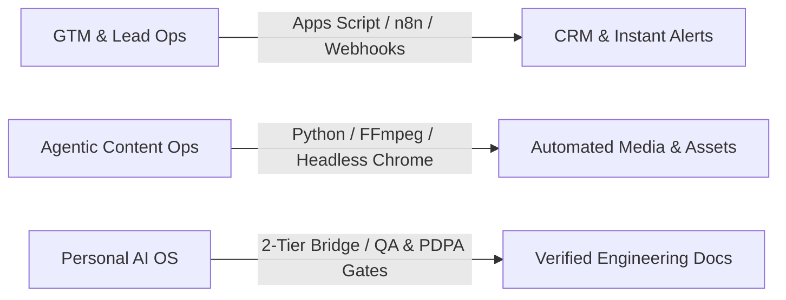

# Hi, I'm Sinlapachai Kaeobunrueang (Apec) 👋

**AI & Automation Specialist | GTM Engineer | Agentic Content & AI Marketing Systems**  
📍 Bangkok, Thailand · 🎓 B.S. Digital Technology & Innovation (GPA **3.84**) · 🌐 TOEIC **845** (CEFR B2)

I build reliable, production-hardened automation systems that eliminate manual bottlenecks across **Go-To-Market (GTM)**, **CRM lead routing**, and **agentic media/content pipelines**.

---

## 🚀 Featured Projects

| Repository | What It Does | Key Stack & Verification |
| :--- | :--- | :--- |
| **[fast-lead-automation](https://github.com/ApecSinlapachai/fast-lead-automation)** | Zero-SaaS-overhead lead intake & multi-platform n8n v2.0 router (`X`, `FB Page/Group`, `LinkedIn`, `Google Forms` → `Sheets Mini-CRM` → `LINE Flex v2 + < 1 min Auto-Reply`) | `Google Apps Script` · `n8n v2.0 (MCP)` · `LINE Messaging API` · **85/85 Automated Offline Tests (`45` + `28` + `12`)** |
| **[agentic-media-pipeline](https://github.com/ApecSinlapachai/agentic-media-pipeline)** | Zero-dependency Python + FFmpeg CLI for automated silence-cutting (`27m → 10m`) and `-16 LUFS` broadcast loudness normalization | `Python` · `FFmpeg 9.x` · `HTML/CSS` · `Chrome Headless` |
| **[ai-automation-til](https://github.com/ApecSinlapachai/ai-automation-til)** | Public engineering log (`TIL #001–#023`) covering Personal AI OS context engineering, multi-agent workflows, n8n MCP testing, security hardening, and PDPA-safe sync pipelines | `AI Systems` · `Context Engineering` · `PowerShell` · `Markdown` |

---

## 🏗️ Systems Focus

---

## 🛠️ Core Technical Stack
- **Automation & GTM Engineering:** Google Apps Script, n8n, REST Webhooks & APIs, Google Sheets Mini-CRM, LINE Messaging API (Flex Cards), Automated Email Routing (`< 1 min` SLA), Lead Deduplication & Scoring
- **AI & Agentic Systems:** LLM Context Engineering, Multi-Agent & Skill Orchestration, Automated QA & Input/Formula-Injection Sanitization, PDPA & Secret Guardrails
- **Scripting & Ops:** Python, FFmpeg, HTML/CSS, Chrome Headless Rendering, PowerShell, Node.js (Offline Mock Testing), Git

---

## 📫 Connect
- **LinkedIn:** [linkedin.com/in/apec-sinlapachai](https://www.linkedin.com/in/apec-sinlapachai)
- **Email:** `sinlapachai.kaeobunrueang@gmail.com`
- **YouTube:** [Apec Sinlapachai](https://youtu.be/V7EboxNpv0Y)
